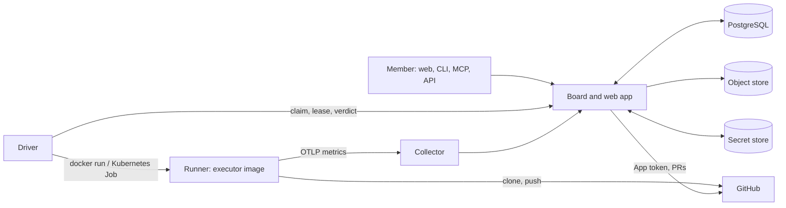

Bellows is open source. You can run the whole platform on your own machine or cluster instead of using [bellows.cloud](https://bellows.cloud). The product works the same way: a task runs an agent in a sandboxed runner, the [gates](/guides/gates) check the result, and a pull request is published.

## Components

| Component | What it does | Required |
| --- | --- | --- |
| **Web app and board (server)** | One Node process (`server/`). Serves the web app and its API, the [MCP endpoint](/mcp/tools) when enabled, and the job board. Keeps tasks, members, settings and telemetry in Postgres. | Yes |
| **Driver** | Polls the board for queued tasks, claims them with a lease, and starts one runner per task. It is the only process that starts containers or pods. | Yes |
| **Runners** | A container (Docker) or a Job pod (Kubernetes) per task. The agent works on a copy of your repository on a task volume. | Yes |
| **Executor images** | The images a runner starts from: `claude-executor` for Claude Code and `opencode-executor` for OpenCode. You build or pull them yourself. | Yes |
| **PostgreSQL** | The only database. Holds everything the board knows. | Yes |
| **GitHub App** | Lets Bellows read repositories, list them, and mint short-lived tokens for runners. It also defines your organizations: one installation is one organization. | Yes |
| **GitHub OAuth App** | Signs members in when `AUTH_MODE=github`. A separate registration from the GitHub App. | For sign-in |
| **Secret store** | Holds environment secrets and connection credentials. Backend is `database`, `aws`, `vault` or `gcp`. | Yes |
| **Object store** | Holds task artifacts and uploaded attachments. S3-compatible, or a local directory on a single replica. | Yes (defaults to the filesystem) |
| **Telemetry collector** | An OpenTelemetry collector. Receives metrics from runners and forwards them to the board. | Recommended |
| **Jira app** | An Atlassian OAuth app that powers **Connect Jira**. | Optional |

## How a task flows

<Steps>
  <Step title="You create a task">
    From the web app, the CLI, the MCP server or the API. The board stores it as a queued job in Postgres.
  </Step>
  <Step title="The driver claims it">
    The driver polls the board (every 5 seconds by default) and takes a lease on the job. The claim carries the repository, the executor, your environment variables and the plan read from `.bellows.yaml`.
  </Step>
  <Step title="A runner starts">
    The driver creates a task volume, starts a runner from the executor image, and clones the repository with a token the board minted from the GitHub App.
  </Step>
  <Step title="The agent works">
    The runner reports progress and questions to the board. Its telemetry goes to the collector, which forwards it to the board.
  </Step>
  <Step title="Gates run">
    The driver runs the gates declared in `.bellows.yaml`, plus any [services](/guides/services) the repository declares.
  </Step>
  <Step title="A PR is published">
    The board publishes the pull request through the GitHub App and keeps following it. Logs, artifacts and the verdict stay on the task.
  </Step>
</Steps>

<Note>
  The board never starts containers. If the driver is down, queued tasks wait until a driver claims them. A driver that is stopped cleanly hands its running tasks back to the board (see `DRIVER_HANDOVER_MS`).
</Note>

## What you need

| Need | Details |
| --- | --- |
| **PostgreSQL** | PostgreSQL 17 is what the Compose file and the local Helm state chart run. No extensions are needed, so a managed Postgres works. |
| **Docker or Kubernetes** | Docker (with Compose) on one machine for a trial. A Kubernetes cluster with the Helm chart for a team. The driver is told which with `EXECUTOR=docker` or `EXECUTOR=kubernetes`. |
| **A GitHub App** | Id and private key are required. The board refuses to start without them. See [GitHub App](/self-host/github-app). |
| **A GitHub OAuth App** | For member sign-in. See [GitHub App](/self-host/github-app). |
| **A model credential** | For example `CLAUDE_CODE_OAUTH_TOKEN` or `ANTHROPIC_API_KEY` for Claude Code, passed to runners by the driver. |
| **A domain and TLS** | Needed for any shared deployment. Set `PUBLIC_URL` to the public https origin; the session cookie is then `Secure` without further setting. MCP needs an https `PUBLIC_URL`. A local trial can use `http://127.0.0.1`. |
| **Node.js 22 or newer** | Only to run `npm run secrets:init` and the CLI from a clone. |

<Warning>
  The Docker executor mounts the Docker socket into the driver. That is root on the host. Read [Security](/self-host/security) before running it anywhere shared.
</Warning>

## Where to go next

<CardGroup cols={2}>
  <Card title="Docker Compose" icon="docker" href="/self-host/docker-compose">
    Run Bellows on one machine with the Docker executor.
  </Card>
  <Card title="Kubernetes" icon="dharmachakra" href="/self-host/kubernetes">
    Deploy with the Helm chart. Each task is a pod.
  </Card>
  <Card title="GitHub App" icon="github" href="/self-host/github-app">
    Register the App and the OAuth App.
  </Card>
  <Card title="Jira app" icon="link" href="/self-host/jira-app">
    Turn on Connect Jira with an Atlassian OAuth app.
  </Card>
  <Card title="Configuration" icon="sliders" href="/self-host/configuration">
    Every server and driver environment variable.
  </Card>
  <Card title="Security" icon="shield" href="/self-host/security">
    What each credential grants and where the boundaries are.
  </Card>
</CardGroup>
